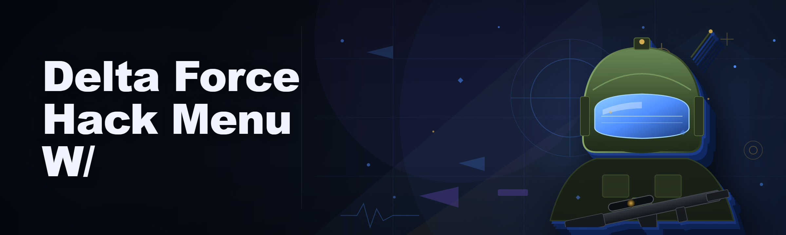
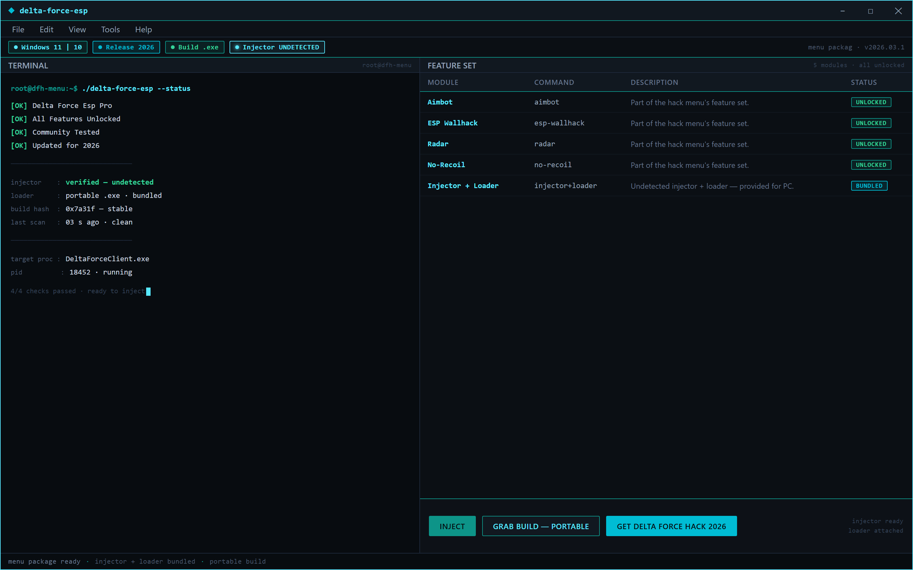
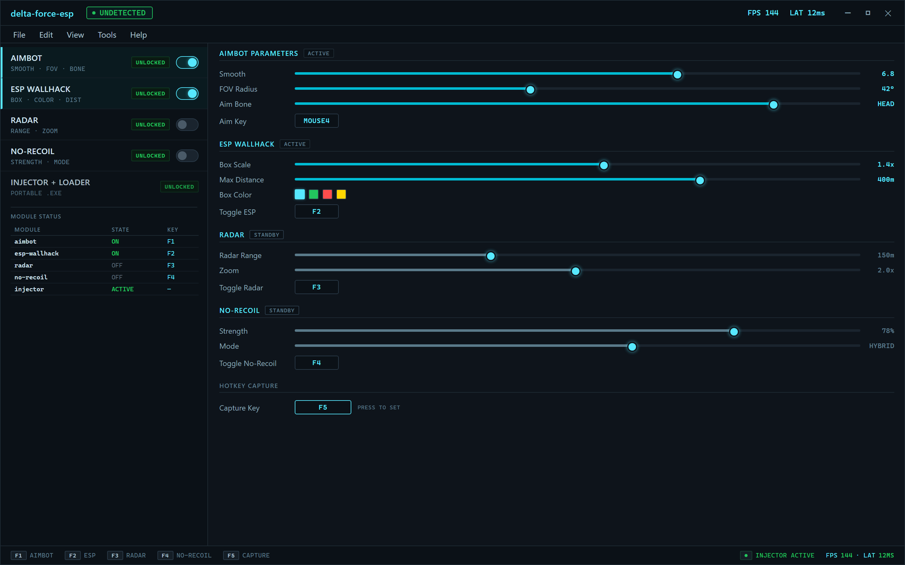
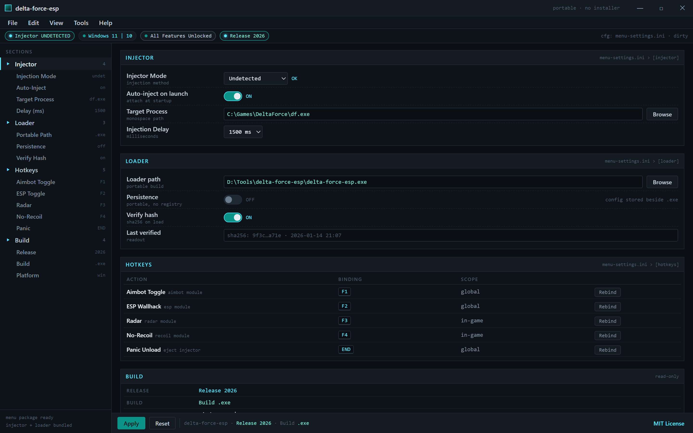

Loader shell — verifies the portable .exe build and pushes the menu package into the game.

  
  
  

  

  
  

---

Delta Force hack menu: aimbot, ESP wallhack, radar, no-recoil, undetected injector + loader for PC.

## Overview

Delta Force hack menu: aimbot, ESP wallhack, radar, no-recoil, undetected injector + loader for PC.

Overlay menu — every module ships Unlocked; tune aimbot, ESP, radar and no-recoil live.

  

Settings — injector and loader options for the portable 2026 build.

## License

[MIT License](LICENSE)

  

